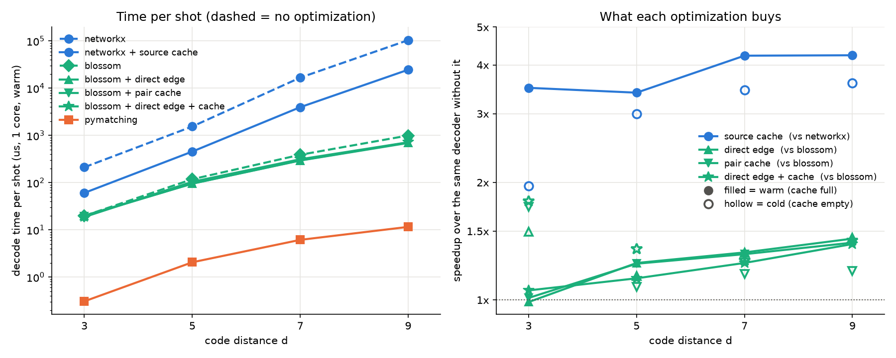
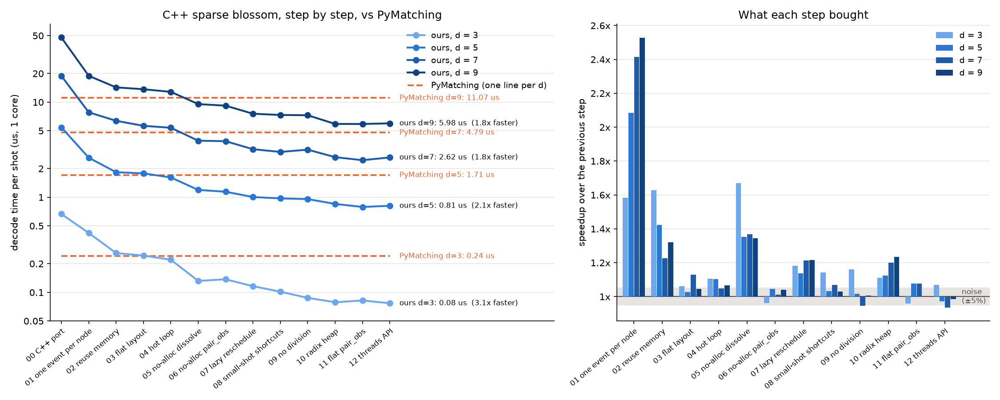
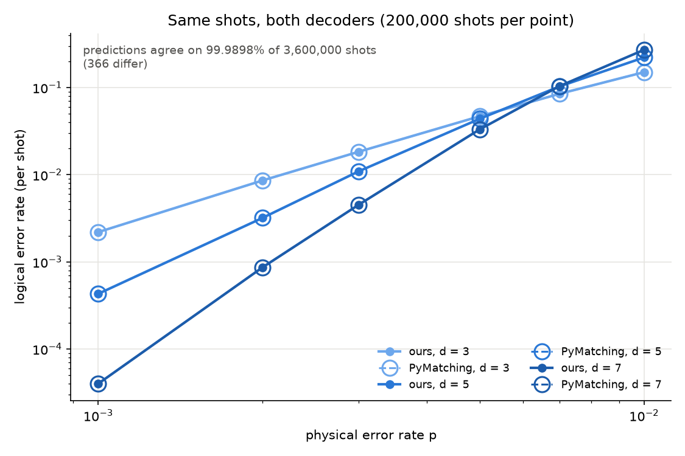
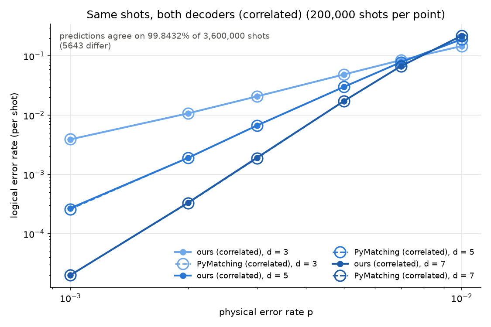
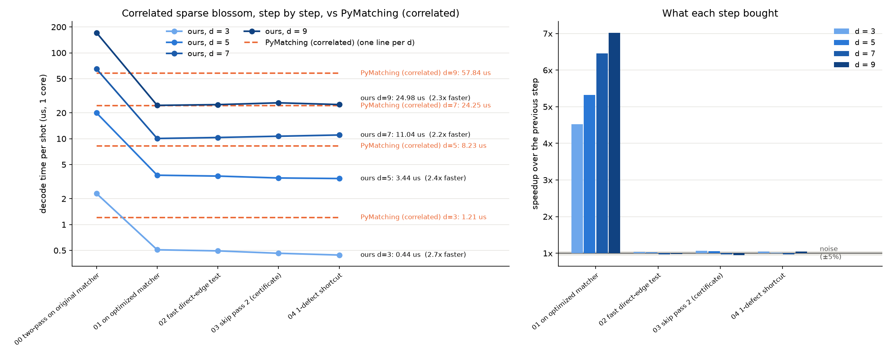

# Decoder optimizations: direct-edge lookup, caching, compiling to C++

Speedups for our matching decoders in `pipeline.py` and `blossom.cpp`, what motivated each one, and
measurements of each on its own and combined.

## Summary

| Optimization | Applies to | Speedup at d = 9 | Keep? |
|---|---|---|---|
| Direct-edge lookup | sparse blossom | about 30% faster (996 → 694 µs/shot) | **Yes.** No warm-up, no memory, exact. |
| Pair cache | sparse blossom | about 29% faster once warm (996 → 711 µs) | Not needed on top of the direct-edge lookup. |
| Source cache | Dijkstra + networkx | **4.2× faster** (104 → 24.6 ms/shot) | Only as a comparison point. It costs about 75 MB per process, and blossom is still 35× faster. |
| Compiling to C++ | sparse blossom | **15× faster** (677 → 46.6 µs/shot) | **Yes.** It's now ~4× slower than PyMatching, down from ~60×. See section 4. |
| Optimizing the C++ (12 steps) | sparse blossom (C++) | **8× faster** (47.8 → 5.98 µs/shot) | **Yes.** Now **1.8–3.1× faster than PyMatching** on one core. See section 5. |
| Correlated matching (4 steps) | sparse blossom (C++), correlated | 2.3–3.0× faster than PyMatching's correlated mode | **Yes.** Same answers as PyMatching (99.9–100% agreement, matching error rates). See section 6. |

Every variant gave exactly the same prediction as PyMatching on every shot it decoded (100% agreement at
every distance).

## Setup

- **Circuit:** `surface_code:rotated_memory_z`, 3d rounds, circuit-level noise p = 0.1%, d = 3, 5, 7, 9.
- **Timing:** each decoder decodes the same freshly sampled shots on one core, so only decoding is
  timed, not sampling.
- **Cold and warm:** each variant decodes three batches of shots with the same decoder object.
  - **cold** = the first batch, when caches start empty
  - **warm** = the average of the second and third batches, when caches are already full
- **Correctness:** every variant's predictions are compared with PyMatching's on the same shots.
- **Repeats:** the blossom variants were run 3 times with 3,000 shots per batch, and the median is
  reported. The networkx variants were run once with 1,000 shots per batch, because they take
  ~100 ms/shot at d = 9.

**Timing noise:** for a decoder without a cache, cold and warm should be equal. They sometimes differ
by 10–20%, and by up to 2× at d = 3 where each shot takes only microseconds. Treat differences
smaller than about 10% as noise.

## Starting point: where the time goes

Before optimizing, I profiled both decoders on real shots.

| d | networkx: share in Dijkstra | blossom: share in `path_obs` |
|---|---|---|
| 5 | 70% | 20% |
| 7 | 77% | 25% |
| 9 | 75% | 33% |

- **Dijkstra + networkx** (`decode_one`) runs one shortest-path search from every lit detector, then
  a dense matching. About three quarters of its time is the searches.
- **Sparse blossom** (`decode_one_blossom`) never computes distances between lit detectors. Its only
  shortest-path work is afterwards: for each matched pair it runs a small search (`path_obs`) to find
  the pair's observable parity (`obs`). That's 20–33% of its time.

Each optimization below targets one of these two costs.

---

## 1. Direct-edge lookup (sparse blossom)

### Motivation

At p = 0.1%, most shots contain only isolated faults, and **one fault flips the two detectors at the
ends of one edge**. Sparse blossom almost always pairs those two detectors with each other. So a matched
pair is nearly always joined by a single edge, and its `obs` is just that edge's `obs_mask`. Searching
for it is wasted work.

Measured share of matched pairs joined by a single edge: 99.5% (d = 5), 99.3% (d = 7), 99.2% (d = 9).

### Implementation

`direct_edge_obs(graph)` builds a dictionary `{(u, v): obs_mask}` once, when the decoder is created.
`decode_one_blossom` looks up each matched pair there first, and only calls `path_obs` if the pair
isn't in it.

### Why it's exact

The direct edge must actually be a **shortest** path; otherwise its `obs` could differ from the
shortest path's. Every edge weight is positive, so any route of two or more edges weighs at least
`2 × (lightest edge)`. An edge no heavier than that is therefore guaranteed to be a shortest path, and
only those edges go into the dictionary. At p = 0.1%, weights range from about 5.2 to 8.2, so every edge
qualifies. At other noise levels, heavier edges are left out and fall back to the search.

### Result

| d | blossom | + direct edge | change |
|---|---|---|---|
| 5 | 118 µs | 95 µs | −20% |
| 7 | 389 µs | 294 µs | −24% |
| 9 | 996 µs | 694 µs | −30% |

The savings line up with the profile: they're about the share of time `path_obs` took (20 / 25 / 33%).
The lookup needs no warm-up: cold and warm times are the same.

---

## 2. Pair cache (sparse blossom)

### Motivation

The same pairs of detectors get matched again and again across shots. Most faults are of a few kinds,
the graph is fixed, and there are only 2,160 detectors at d = 9. So the `obs` for a pair, once
computed, could be remembered instead of searched for again. Unlike the direct-edge lookup, this also
covers pairs that are *not* joined by a single edge.

### Implementation

A dictionary from `(min(x, y), max(x, y))` to `obs` that keeps growing across shots. Shortest paths
work the same in both directions, so each pair is stored once.

### Result

| d | cache hit rate | blossom | + pair cache (warm) | + pair cache (cold) |
|---|---|---|---|---|
| 5 | 93.8% | 118 µs | 96 µs | 115 µs |
| 7 | 93.3% | 389 µs | 297 µs | 335 µs |
| 9 | 93.0% | 996 µs | 711 µs | 829 µs |

Once warm, the pair cache does about as well as the direct-edge lookup: both replace a search with a
dictionary lookup. But it's worse in every other way:
- **It needs warming up.** The first time it sees each pair, it still searches, so the cold times are
  slower.
- **Its memory keeps growing.** It's small here, at about 12,000 pairs for d = 9 over 9,000 shots.
- **It covers what the direct edge already does.** About 99% of the pairs it caches are single edges
  anyway.

### Combined with the direct-edge lookup

| d | + direct edge | + direct edge + pair cache |
|---|---|---|
| 5 | 95 µs | 104 µs |
| 7 | 294 µs | 313 µs |
| 9 | 694 µs | 716 µs |

There's no extra gain: the differences are within timing noise. With the direct edge on, only about
0.7% of pairs ever reach the cache, and those are mostly different pairs each time (24 cache hits out of
81,555 pairs at d = 7). **The direct-edge lookup alone is the one to keep.**

---

## 3. Source cache (Dijkstra + networkx)

### Motivation

In the networkx decoder, Dijkstra is three quarters of the time.
- **Caching by pair** (the distance between two lit detectors) works poorly. Every pair of lit
  detectors in a shot needs a distance, most of those pairs are far apart and random, and only
  11–35% of them repeat across shots.
- **Caching by starting detector** works well. The graph is small, so after a few hundred shots
  nearly every detector has already been the starting point of a search: 90–97% hit rate.

So the cache stores one **complete** Dijkstra result (distance and `obs` to every node) per starting
detector. Later shots just read the entries they need.

### Implementation

`dijkstra_all(source, adj, boundary)` runs Dijkstra to completion instead of stopping once it has
found the current shot's targets, and returns numpy arrays. `decode_one` with `source_cache=True`
computes each starting detector's arrays the first time it's needed, then reuses them. On every later
shot, the per-shot searches are replaced by array lookups.

### Result

| d | detectors | networkx | + source cache (warm) | speedup | memory when fully cached |
|---|---|---|---|---|---|
| 5 | 360 | 1,547 µs | 456 µs | 3.4× | 2 MB |
| 7 | 1,008 | 16.7 ms | 3.97 ms | 4.2× | 16 MB |
| 9 | 2,160 | 104 ms | 24.6 ms | 4.2× | 75 MB |

- **Warm-up is short.** At d = 9 all 2,160 detectors were cached within the first 1,000 shots, and
  98% of later lookups hit.
- **What's left is the matching.** After caching, nearly all the remaining time is networkx's dense
  matching, so about 4× is the ceiling for this decoder.
- **Memory grows quickly.** It scales with (detectors)², which is roughly d⁶: about 4× larger at
  d = 11. Under sinter, each worker process builds its own cache, so 22 workers at d = 9 would use
  about 1.6 GB. That's why `source_cache` is off by default.

---

## Full ablation (warm µs per shot, 1 core)



- **Left:** time per shot for every variant, on a log scale. Colour = decoder family; dashed = no
  optimization.
- **Right:** how much faster each optimization makes its own decoder. Filled markers = warm (cache
  full); hollow = cold (first batch, cache empty). The scattered d = 3 hollow markers are timing noise:
  each shot takes only microseconds there.

| d | networkx | + source cache | blossom | + direct edge | + pair cache | + both | PyMatching |
|---|---|---|---|---|---|---|---|
| 3 | 212* | 61 | 19.8 | 20.1 | 19.6 | 18.7 | 0.3 |
| 5 | 1,547 | 456 | 118 | 95 | 96 | 104 | 2.1 |
| 7 | 16,749 | 3,965 | 389 | 294 | 297 | 313 | 6.1 |
| 9 | 104,149 | 24,595 | 996 | 694 | 711 | 716 | 11.6 |

\*d = 3 is dominated by timing noise: the networkx row with no cache measured 94 µs cold and 212 µs
warm.

### Caching: cold vs warm, hit rate, memory

"Cold" is the first batch, starting from an empty cache. "Warm" is later batches, after the cache has
filled. The rows without a cache are included to show how much cold and warm differ from noise alone.

| d | Variant | Cold µs/shot | Warm µs/shot | Cache hit rate | Cache size at end |
|---|---|---|---|---|---|
| 3 | networkx (no cache) | 94 | 212* | – | – |
| 3 | networkx + source cache | 48 | 61 | 97.6% | 72 sources, 84 KB |
| 3 | blossom (no cache) | 33.6 | 19.8 | – | – |
| 3 | blossom + pair cache | 19.4 | 19.6 | 94.9% | 268 pairs |
| 3 | blossom + direct edge + cache | 18.8 | 18.7 | – (all direct edges) | 0 pairs |
| 5 | networkx (no cache) | 1,645 | 1,547 | – | – |
| 5 | networkx + source cache | 549 | 456 | 97.8% | 360 sources, 2.1 MB |
| 5 | blossom (no cache) | 124 | 118 | – | – |
| 5 | blossom + pair cache | 115 | 96 | 93.8% | 1,763 pairs |
| 5 | blossom + direct edge + cache | 92 | 104 | 3.3% of the 0.5% not direct | 145 pairs |
| 7 | networkx (no cache) | 15,930 | 16,749 | – | – |
| 7 | networkx + source cache | 4,614 | 3,965 | 98.0% | 1,008 sources, 16 MB |
| 7 | blossom (no cache) | 390 | 389 | – | – |
| 7 | blossom + pair cache | 335 | 297 | 93.3% | 5,470 pairs |
| 7 | blossom + direct edge + cache | 309 | 313 | 4.1% of the 0.7% not direct | 560 pairs |
| 9 | networkx (no cache) | 96,877 | 104,149 | – | – |
| 9 | networkx + source cache | 26,951 | 24,595 | 98.1% | 2,160 sources, 75 MB |
| 9 | blossom (no cache) | 982 | 996 | – | – |
| 9 | blossom + pair cache | 829 | 711 | 93.0% | 12,298 pairs (about 1 MB) |
| 9 | blossom + direct edge + cache | 691 | 716 | 4.7% of the 0.8% not direct | 1,305 pairs |

How these were counted:
- **Hit rates** are over all lookups. That's 3,000 shots for the source cache (one run of 3 × 1,000) and
  9,000 shots for the pair caches (3 × 3,000, from the first of the three repeat runs).
- **"Sources"** = detectors with a stored full Dijkstra result. Each costs (detectors + 1) × 16 bytes.
- **"Pairs"** = dictionary entries: one per search the cache had to run.

What the table shows:
- **Source cache:** it already pays off in the cold batch. Every detector gets cached within the first
  1,000 shots, and after that 98% of lookups hit. At d = 9 even the cold batch is 3.6× faster than no
  cache.
- **Pair cache alone:** the warm-up cost is visible. At d = 9 the cold batch saves 16% (982 → 829 µs),
  compared with 29% once warm (996 → 711 µs), because the first time it sees each pair it still searches.
- **Pair cache with the direct edge on:** it almost never hits (about 4% of the 0.5–0.8% of pairs that
  aren't a single edge). Those leftover pairs are mostly different every shot, so caching them gains
  nothing.

Fastest version of each decoder at d = 9, compared with PyMatching:
- **Dijkstra + networkx + source cache:** about 2,100× slower
- **sparse blossom + direct edge:** about 60× slower

## Takeaways

1. **Profile first.** The direct-edge lookup was found by asking what the remaining searches were
   actually for. The answer, "a pair joined by one edge" 99% of the time, made the fix obvious.
2. **Prefer facts about the structure to caches.** The direct-edge lookup and the pair cache save about
   the same time. But the lookup relies on a fact that's always true (one fault, one edge), while the
   cache relies on a statistical pattern (pairs repeat), which needs warm-up, memory and a hit rate.
3. **Caching can't fix a slow algorithm.** The source cache gave the networkx decoder its 4×, but
   switching to sparse blossom gave about 100×, and still more as d grows.

## 4. Compiling sparse blossom to C++

### Motivation

After the direct-edge lookup, profiling at d = 9 showed about 423 priority-queue events per shot at
about 1.7 µs each. That's the cost of Python function calls and object allocation, not of the work
itself. And the gap to PyMatching stayed roughly constant from d = 3 to 9 (35–60×), which is what
you'd expect from the same algorithm in a slower language. Threads can't help, because Python's
global interpreter lock lets only one thread run Python code at a time. Separate processes only
multiply the number of shots per second (about 3–5× on this laptop); they don't make any single
shot faster.

### Implementation

- `blossom.cpp` is a step-by-step port of `sparse_blossom_match`. Regions are stored in a
  `std::vector` and referred to by index instead of being Python objects.
- It's compiled with MinGW `g++` into `blossom.dll` and called through `ctypes`, so no Python headers
  or Visual Studio are needed. `load_compiled_blossom()` rebuilds the DLL automatically if
  `blossom.cpp` is newer.
- It also does three things the Python version doesn't:
  - a whole batch of shots is decoded in one call, so there's no Python work per shot;
  - only the nodes a shot touched are reset afterwards;
  - the direct-edge lookup is built in, with a Dijkstra fallback.
- Use it with `MyCompiledDecoder(dem, method="compiled")`, or `"mine_compiled"` in
  `run_sinter_benchmark`.

### Correctness

On identical shots, the compiled decoder agreed with PyMatching on:
- 100% of shots at p = 0.1% (20,000 shots at d = 3 and 5; 10,000 at d = 7; 5,000 at d = 9)
- 100% at high noise (1,000 shots at d = 7, p = 1.2%; 500 at d = 9, p = 0.8%), where blossoms
  form and break apart constantly

The only exceptions were 3 of 3,000 shots at d = 5, p = 1.2%. All three are **exact ties**: our
matching and PyMatching's have the same total weight to 4 decimal places, but pick different options
that predict different logical values. On those shots, the Python version made the same choice as the
C++ one.

### Speed (µs per shot, one core, median of 3 runs on identical shots, p = 0.1%)

| d | Python sparse blossom | C++ sparse blossom | PyMatching | C++ vs Python | C++ vs PyMatching |
|---|---|---|---|---|---|
| 3 | 21.3 | 0.59 | 0.23 | 36× faster | 2.5× slower |
| 5 | 85.8 | 5.59 | 1.48 | 15× faster | 3.8× slower |
| 7 | 277 | 18.4 | 4.90 | 15× faster | 3.7× slower |
| 9 | 677 | 46.6 | 10.8 | 15× faster | 4.3× slower |

What this shows:
- **Compiling closed most of the gap:** from about 60× slower than PyMatching to about 4× slower.
- **The remaining ~4× is algorithmic.** The C++ version still recomputes event times for *every* node
  of a region whenever the region changes state, including interior nodes that can't collide with
  anything. It also allocates new vectors for those lists every time. PyMatching works only on a
  region's outer layer of nodes, and also uses a faster priority queue and compressed edges.
- **Measurement noise:** these timings swing widely on this laptop. Its fast and slow cores and its
  power limits caused swings of up to 4× between runs of the same build, which is why the table uses
  medians of three. A comparison of `-O2` against `-O3 -march=native` was too noisy to conclude
  anything, so the portable `-O2` build is kept.

## 5. Making the C++ faster than PyMatching

Starting from the direct C++ port (section 4), each step below is one change on top of the
previous one. Every step is saved as its own source file in `blossom_steps/stepNN_*.cpp`, so the whole
table can be rebuilt and re-measured with `python compiled_ablation.py`.

### How it was measured

- **Same shots for everything:** each distance uses one fixed set of shots at p = 0.1%
  (200k at d = 3, 100k at d = 5, 40k at d = 7, 20k at d = 9).
- **Less timing noise:** the process is pinned to one fast core at high priority, and every step
  is timed in 7 rounds alternating with PyMatching. Reported times are medians.
- **Noise level:** two builds of the identical source measured 1–3% apart, so step-to-step changes
  under about 5% are noise.
- **Correctness on every step:**
  - its predictions are compared with PyMatching's on all those shots;
  - at high noise (d = 5 and 7 at p = 1.2%, d = 9 at p = 0.8%), where blossoms form and break apart,
    every shot where it disagrees with PyMatching must have the same total matching weight.

  All 13 steps passed.

### Ablation (µs per shot, one core; in brackets: time as a multiple of PyMatching's)



- **Left:** time per shot after each step (log scale), one blue line per distance. Each distance
  has its own orange dashed line for PyMatching, because PyMatching's time also grows with d
  (0.24 → 11.1 µs from d = 3 to 9). Where a blue line drops below its own orange line, our decoder
  becomes faster than PyMatching at that distance.
- **Right:** how much faster each step made the decoder compared with the step before. Bars inside
  the grey ±5% band are within timing noise.
- Running `python compiled_ablation.py` with no arguments re-measures everything and redraws the
  plot; `compiled_ablation.plot_ablation()` redraws it from the saved results.

| Step | Change | d = 3 | d = 5 | d = 7 | d = 9 |
|---|---|---|---|---|---|
| 00 | Direct C++ port of the Python version | 0.667 (2.77×) | 5.43 (3.17×) | 18.9 (3.94×) | 47.8 (4.32×) |
| 01 | One live event per node | 0.421 (1.75×) | 2.61 (1.52×) | 7.82 (1.63×) | 18.9 (1.71×) |
| 02 | Reuse region slots; walk nodes without allocating | 0.259 (1.08×) | 1.83 (1.07×) | 6.37 (1.33×) | 14.3 (1.29×) |
| 03 | Flat neighbour arrays, 24-byte events | 0.244 (1.01×) | 1.78 (1.04×) | 5.64 (1.18×) | 13.7 (1.23×) |
| 04 | Hoisted inner loop, small "hot" region array | 0.220 (0.92×) | 1.62 (0.94×) | 5.38 (1.12×) | 12.8 (1.16×) |
| 05 | No allocation in `dissolve` | 0.132 (0.55×) | 1.20 (0.70×) | 3.93 (0.82×) | 9.54 (0.86×) |
| 06 | No allocation in the `pair_obs` fallback | 0.137 (0.57×) | 1.14 (0.67×) | 3.88 (0.81×) | 9.18 (0.83×) |
| 07 | Lazy rescheduling | 0.116 (0.48×) | 1.01 (0.59×) | 3.20 (0.67×) | 7.55 (0.68×) |
| 08 | Exact shortcuts for 1–2 lit detectors; precomputed boundary `obs` | 0.102 (0.42×) | 0.97 (0.57×) | 3.00 (0.63×) | 7.33 (0.66×) |
| 09 | No division in the inner loop | 0.088 (0.36×) | 0.96 (0.56×) | 3.17 (0.66×) | 7.28 (0.66×) |
| 10 | Radix heap | 0.079 (0.33×) | 0.85 (0.50×) | 2.64 (0.55×) | 5.90 (0.53×) |
| 11 | `pair_obs` reads the flat arrays; one-pass region search | 0.082 (0.34×) | 0.79 (0.46×) | 2.45 (0.51×) | 5.89 (0.53×) |
| 12 | Threaded batch API (single-thread path unchanged) | **0.077 (0.32×)** | **0.81 (0.48×)** | **2.62 (0.55×)** | **5.98 (0.54×)** |

Overall result on one core:
- **The final version is 1.8–3.1× faster than PyMatching:** 3.1× at d = 3, 2.1× at d = 5, 1.8× at
  d = 7 and 1.9× at d = 9.
- **It's 7–9× faster than the direct port it started from.**
- PyMatching took 0.24, 1.71, 4.79 and 11.1 µs per shot at d = 3, 5, 7, 9 in the same runs.

### What each step did, and why

**01: One live event per node (2.1–2.5×, the biggest single gain).**
Profiling the port showed 422 priority-queue pushes per shot at d = 9, and **95% of them were stale**
by the time they were popped. `schedule_node` pushed one event per edge (about 5 per call), and most
were invalidated as soon as nearby regions changed. Now each node keeps only its earliest edge event,
tagged with a version number:
- a newer version makes older events dead, which is checked cheaply when they pop;
- an event that has gone out of date is re-derived when it pops;
- a node whose event was used up is rescheduled.

Every change to an edge's timing still reschedules one of its endpoints, so no collision is missed.
Pushes fell to 62 per shot.

**02, 05, 06: Removing memory allocation from the per-shot loop (1.3–1.6×, 1.3–1.7×, ~1.0×).**
A heap allocation costs roughly as much as all the arithmetic in a small shot. Step 02 reuses region
slots (their vectors keep the memory they already reserved) and replaces the `nodes_of` list with an
in-place walk. Step 05 found two vectors that `dissolve` was still allocating on every collision.
That turned out to be a quarter of the remaining run time, and fixing it took the decoder from slower
than PyMatching to faster at every distance. Step 06 removed the allocations in the rare `pair_obs`
fallback. That was correct, but too rare to measure.

**03, 04: Data layout (1.03–1.13×, 1.05–1.11×).** The neighbour lists became one flat array
(compressed sparse row) instead of a separate vector per node, and events shrank from 48 to 24 bytes.
Each region's three frequently used numbers (radius, start time, slope) moved into a small array of
their own, and `schedule_node` now looks up the node's own region once per call instead of once per
neighbour.

**07: Lazy rescheduling (1.14–1.22×).** An edge's event time can only get *earlier* if one of its
regions' slope goes *up*. When a region freezes (growing to frozen) or starts shrinking, all its
events can only move later; the old events are popped early and re-derived. So only regions whose
slope rises (shrinking to frozen, frozen to growing) are rescheduled immediately. This removed most
of the rescheduling after collisions.

**08: Exact shortcuts for small shots (1.14× at d = 3, ~1.03–1.07× elsewhere).** With one lit
detector, the matching is just "go to the boundary", and the boundary path's `obs` is precomputed per
detector with a single search from the boundary. With two lit detectors joined by a shortest-path
edge, the answer is whichever is cheaper: that edge, or both boundary distances (in the same integer
weights the matching uses). Exact ties go to the general algorithm. In general shots, the precomputed
boundary `obs` also replaces the `pair_obs` search for every boundary pair.

**09: No division (~1.0–1.16×, mostly within noise).** The inner loop divided by a slope sum that is
always 1 or 2. Dividing by those is exact in floating point, so `x / s` became the bit-identical
`s == 2 ? x * 0.5 : x`.

**10: Radix heap (1.11–1.23×).** Event times never go backwards, which is the property a radix heap
needs. The key is the raw bit pattern of the time, since non-negative doubles' bit patterns sort the
same as the numbers. A push is O(1), and a 64-bit mask of non-empty buckets finds the next bucket
with one bit-scan instruction. The first version cleared all 65 buckets every shot and was 0.81×
slower at d = 3; clearing became O(1) once it was clear the queue is always empty at the end of a shot.

**11, 12: Clean-ups (~1.0×).** `pair_obs` now reads the flat arrays, and the top-level-region search
no longer takes time proportional to the square of the number of regions. Step 12 adds the threaded
API without changing the single-thread path. Both are within noise, as expected.

### Tried and rejected: compiler flags

Built from the step-11 source and measured in the same way:

| Build | d = 3 | d = 5 | d = 7 | d = 9 |
|---|---|---|---|---|
| `-O2` (kept) | 0.088 | 0.832 | 2.52 | 6.08 |
| `-O3` | 0.085 | 0.799 | 2.48 | 6.31 |
| `-O3 -march=native` | 0.092 | 0.895 | 3.08 | 6.40 |

`-O3` is within noise, and `-march=native` was slower (and makes the DLL non-portable). The sources
are in `blossom_steps/rejected/`.

### Throughput with threads

The C++ code has no global interpreter lock, and `ctypes` releases Python's lock during the call.
So `sb_decode_batch_mt` splits a batch over real threads, each with its own copy of the decoder's
per-shot state; the graph is only ever read. Not pinned to a core, median of 3 runs:

| Threads | d = 5 (M shots/s) | × PyMatching | d = 9 (M shots/s) | × PyMatching |
|---|---|---|---|---|
| PyMatching, 1 thread | 0.61 | 1.0× | 0.090 | 1.0× |
| 1 | 1.24 | 2.0× | 0.17 | 1.8× |
| 4 | 3.74 | 6.1× | 0.63 | 7.0× |
| 8 | 8.19 | 13.4× | 0.67 | 7.5× |
| 16 | 8.21 | 13.4× | 1.04 | 11.5× |
| 22 | **9.30** | **15.2×** | **1.16** | **12.9×** |

- Threads were bit-identical to a single thread in every run.
- They scale much better than Python processes did (7× from 1 to 22 threads, against 3–5× with
  processes), but not smoothly, because of this laptop's mix of fast and slow cores.
- The fair comparison is still the single-core table above. PyMatching could be parallelised across
  processes too.
- In `pipeline.py` this is `MyCompiledDecoder(dem, method="compiled", threads=N)`. Leave `threads=1`
  under sinter, which already runs one worker process per core.

### Correctness of the final version

- **634,500 shots** across d = 3, 5, 7, 9, 11 and p = 0.05%, 0.1%, 0.3%, 0.6%, 1% and 1.5%, two seeds
  each, compared with PyMatching.
- **57 disagreements (0.009%)**. Every one has the same total matching weight as PyMatching's, to
  within 1.4×10⁻⁵ relative. Both decoders round weights to integers, so these are equally optimal
  choices between near-ties.
- The threaded path matched the single-threaded path on every shot.



The same check, as a plot: 3,600,000 shots (d = 3, 5, 7 and six noise levels, 200,000 shots per
point), both decoders on identical shots. The two sets of curves lie on top of each other; 366
predictions (0.01%) differ.

## 6. Correlated matching (branch `correlated-blossom`)

### What it is

Plain matching splits every hyperedge (a fault that lights 3–4 detectors) into independent graph
edges and forgets that the pieces belong together. Correlated matching puts that link back. Our
implementation follows PyMatching's `enable_correlations=True` exactly, as read from its source:

1. **Rules, built once from the DEM.** For every pair of edges e, f that are pieces of the same
   decomposed fault:
   - `joint[e][f]` = probability (XOR-accumulated) of the faults containing both;
   - `joint[e][e]` = probability of every fault containing e, decomposed or not.

   If e gets used, f may be lowered to the weight of `q = min(0.5, joint[e][f] / joint[e][e])`.
   That's `compiled_correlation_rules` in `pipeline.py`. At d = 9 there are about 58,000 rules,
   roughly 5 per edge. A typical implied weight is about 0.44× the edge's normal weight.
2. **Pass 1:** ordinary matching. Then walk each matched pair's shortest path and keep the edges
   used an odd number of times (an edge used by two paths cancels out).
3. **Reweight:** apply every rule of every used edge. Weights only ever go down; if several rules
   hit the same edge, it keeps the lowest.
4. **Pass 2:** ordinary matching on the reweighted graph. Its paths give the prediction. Then the
   weights are restored.

In C++ this is `decode_correlated` in `blossom.cpp`, switched on with `sb_set_correlations`. In
Python it's `MyCompiledDecoder(dem, method="compiled", correlated=True)`.

Weights change from shot to shot here, so nothing precomputed from the fixed weights can be used:
not the precomputed boundary paths, not the global direct-edge rule, not the small-shot shortcuts.
Path walking instead uses a local rule that stays valid after reweighting: a direct edge x–y is a
shortest path if its weight is at most (lightest other edge at x) + (lightest other edge at y).

### Accuracy: same answers as PyMatching's correlated mode

Identical shots, logical errors counted for each decoder:

| d | p | shots | ours, correlated | PyMatching, correlated | PyMatching, plain | agreement with PyMatching correlated |
|---|---|---|---|---|---|---|
| 3 | 0.1% | 400,000 | 1,603 | 1,603 | 936 | 99.999% |
| 5 | 0.1% | 400,000 | 94 | 96 | 176 | 99.9995% |
| 7 | 0.1% | 100,000 | 1 | 1 | 2 | 100% |
| 9 | 0.1% | 40,000 | 0 | 0 | 0 | 100% |
| 5 | 0.5% | 100,000 | 3,043 | 3,038 | 4,353 | 99.94% |
| 7 | 0.5% | 40,000 | 712 | 713 | 1,369 | 99.90% |

What the table shows:
- **Correlated matching helps a lot from d = 5 up**, roughly 1.4–1.9× fewer errors.
- **At d = 3 it makes things worse** (1,603 errors vs 936). Ours reproduces this exactly, so it's a
  property of the correlated rule itself, not something specific to PyMatching's implementation.
- **The remaining disagreements are not from weight rounding.** Going from 2¹² to 2²⁰ integer
  weight levels changed nothing. They come from pass 1 choosing between equally short paths:
  PyMatching traces paths from the collision point through its own search structure, we run our
  own shortest-path search, and when two paths tie, a different set of edges gets reweighted.



CORRELATED_AGREEMENT_TEXT

### Ablation (µs per shot, one core; in brackets: time as a multiple of PyMatching's correlated mode)



| Step | Change | d = 3 | d = 5 | d = 7 | d = 9 |
|---|---|---|---|---|---|
| c00 | Two-pass correlated matching on the optimized matcher | 0.645 (0.43×) | 4.32 (0.44×) | 13.7 (0.43×) | 32.1 (0.40×) |
| c01 | Faster direct-edge test (one scan, precomputed lightest neighbours) | 0.588 (0.39×) | 4.40 (0.45×) | 13.8 (0.43×) | 31.9 (0.40×) |
| c02 | Skip pass 2 when pass 1's matching provably stays optimal | 0.529 (0.35×) | 4.19 (0.43×) | 13.6 (0.43×) | 32.8 (0.41×) |
| c03 | One lit detector: both passes are just shortest boundary paths | **0.501 (0.33×)** | **4.28 (0.44×)** | **13.7 (0.43×)** | **32.3 (0.41×)** |
| | **PyMatching, correlated** | 1.50 | 9.83 | 31.8 | 79.4 |

**Result: 2.3–3.0× faster than PyMatching's correlated mode.** Almost all of that comes from step
c00: both passes run on the fast matcher from section 5. The correlation-specific steps help only at
d = 3, a combined 1.29×. At d = 5–9 they're within the ±5% timing noise.

This run happened while the laptop was in a slower power state: PyMatching's plain mode measured
about 2.5× slower than in section 5. The ratios are measured in the same rounds and remain valid, but
compare absolute times only within this table.

How the steps were checked:
- Every step was checked at high noise against PyMatching's correlated mode: 99.88–100% agreement,
  with matching error counts.
- Steps c02 and c03 gave **identical predictions** to the previous step on 740,000–750,000 shots
  (d = 3–9, p = 0.1–0.5%).

### Why the correlation-specific steps don't buy much

Profile of step c00 at d = 9:

| Part | Share of time |
|---|---|
| matching, pass 1 | ~33% |
| matching, pass 2 | ~33% |
| walking pass-1 paths (which edges were used) | ~10% |
| reweighting (about 136 edges lowered per shot) | ~10% |
| walking pass-2 paths (the prediction) | ~9% |

Our correlated decode costs about 2.4–2.5× a plain decode. That's close to the floor of "two
matchings plus a bit"; PyMatching's correlated mode costs 2.5–3.5× its own plain mode.

- **c01:** the path walks were already cheap (98–99% use a single edge), so making the test faster
  changed nothing measurable.
- **c02:** this is the only way to avoid a whole pass. At the end of pass 1, the regions are an
  optimal solution. If every reweighted edge still respects them, the old matching stays optimal
  for the new weights, and pass 2 can be skipped. Precisely:
  - endpoints in different regions (or uncovered): `local(a) + local(b) ≤ w'`
  - both endpoints in the same simple region: `|local(a) − local(b)| ≤ w'`
  - inside blossoms: the sum test, which is conservative there

  The test passes on 70% of shots at d = 3 and 45% at d = 5, but only 1% at d = 9. At larger
  distances nearly every shot reweights some edge right next to a matched path, which is the whole
  point of correlated matching. Yet pass 2 changed the prediction on only 52, 9 and 0 of 20,000
  shots at d = 3, 5 and 9.
- **Pass 2 almost never changes the answer** at low p, but it does change the regions, so a test
  based on pass 1's regions can't tell that in advance at d = 9.

## Possible next steps

- **Compressed edges** (what PyMatching does): XOR edge `obs_mask` values into each region while it
  grows, so every matched pair's `obs` is known when regions collide. `pair_obs` is now about 5–8% of
  the time.
- **Only update a region's outer nodes** when a blossom forms or breaks apart. Lazy rescheduling
  already covers the common collisions; blossoms are rare at p = 0.1%.
- **Integer event times.** With even integer weights, PyMatching keeps all event times integral. That
  would allow a simpler bucket queue instead of the radix heap.
- **Correlated: re-solve pass 2 only where needed.** Pass 1's regions are violated only around the
  reweighted edges. Re-matching just the lit detectors involved there, and keeping pass 1's answer
  elsewhere, could remove most of pass 2 at large d. Doing that exactly needs care, because changes
  can spread through blossoms and alternating trees.
- **Correlated: record pass 1's edges during growth** (compressed edges again), instead of walking
  paths afterwards (~10% at d = 9).

## Reproducing

```python
import pipeline
rows = pipeline.run_ablation(drange=(3, 5, 7, 9), shots=1000)   # all six variants + PyMatching
pipeline.plot_ablation(rows)                                     # saves cache_ablation.png
```

(The plot in this document combines two runs: one run of the networkx variants with 1,000 shots per
batch, and the median of three runs of the blossom variants and PyMatching with 3,000 shots per batch.)

The variants are defined in `pipeline.ABLATION_VARIANTS`, and each optimization is a switch on
`MyCompiledDecoder(dem, method=..., direct_edge=..., pair_cache=..., source_cache=...)`.
Defaults: `direct_edge=True`, `pair_cache=False`, `source_cache=False`, following the takeaways above.
